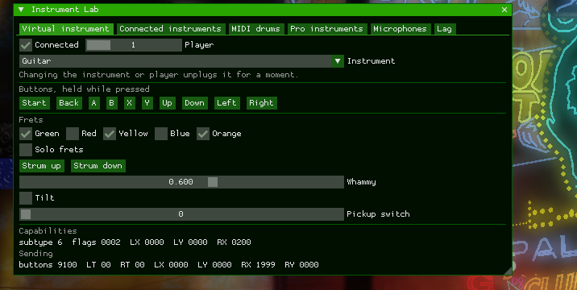

# Instruments and microphones

Controllers are read through SDL by default, or through XInput on Windows with
`input_backend = xinput`. Each controller is its own player, up to four. Gamepads and the
keyboard play as `controller_type` (a guitar by default); real Xbox 360 instruments keep
their own type.

A Rock Band guitar's pickup switch picks the overdrive effect. A Guitar Hero guitar has no
such switch: its tilt sensor sends on the same input, so if the game takes it for a Rock
Band guitar, turning it face up changes the effect mid-song. As on the Xbox 360, band3
plays each guitar as the kind it reports itself (`guitar_type`, the Controllers tab's
**Guitars play as**). It can't tell on Linux, or for a guitar that isn't an Xbox 360 one;
choose Guitar Hero guitars there, or Rock Band guitars to keep a guitar's effect switch.

## Instrument Lab

Press **F6** to open the Instrument Lab. It connects a virtual Xbox 360 instrument
(guitar, drums, keys, or a Mustang or Squier pro guitar) as its own player (player 2
by default) and plays it with the mouse, showing the exact data it sends. It is a tool
for checking how the game reads each instrument without the hardware. Its other tabs
(Connected instruments, MIDI drums, MIDI keyboard, Microphones, Pro instruments, Lag) are
described below.

## PlayStation and Wii instruments (experimental)

Turn on `hid_instruments` (the Controllers tab, on the launcher or in the in-game settings, then restart) to play Rock Band guitars and
drum kits through their USB dongles:

- PS3 and Wii guitars and drum kits, and a PS3 or Wii MIDI Pro Adapter in drum mode
- PS4 guitars (MadCatz Stratocaster, PDP Jaguar) and drum kits (MadCatz, PDP)
- PDP Riffmaster and CRKD Gibson SG, in PS4 or PS5 mode

They show up as Xbox 360 instruments, each as its own player. This is new and hasn't been
tried on every model yet. The Instrument Lab's **Connected instruments** tab shows each
one's raw reports next to what the game receives; if one misbehaves, press **Save a 5
second capture** while playing the part that goes wrong, and include the file it writes
to `logs/` (next to the executable) with the report.

On Linux the dongles need to be readable by your user; install
`tools/linux/70-band3-rock-band-instruments.rules` as described at the top of that file.

The report layouts come from [PlasticBand](https://github.com/TheNathannator/PlasticBand)'s
documentation, cross-checked against
[PlasticBand-Unity](https://github.com/TheNathannator/PlasticBand-Unity).

## Xbox One instruments (experimental)

On Windows, the same `hid_instruments` setting also plays Rock Band 4's Xbox One instruments:

- Guitars: MadCatz Stratocaster, PDP Jaguar, PDP Riffmaster, and the CRKD and Red Octane
  guitars in Xbox mode
- Drum kits: MadCatz, PDP and Red Octane

- **GameInput 3 or newer** is needed: band3 reads these through it, since XInput doesn't list
  them. Many games install it; if the log says it's missing, install Microsoft's GameInput
  redistributable.
- **Wireless** instruments pair through an Xbox Wireless Adapter for Windows (not the Xbox 360
  receiver), as with a console. A Jaguar needs its firmware updated first.
- **No driver change** is needed. Close RB4InstrumentMapper while band3 runs, or both read the
  same instrument.
- **Not read yet:** the Rock Band 4 wireless legacy adapter (its connection is logged). Play a
  360 instrument through an Xbox 360 wireless receiver for Windows instead.

They show up as Xbox 360 instruments, each as its own player, in the Instrument Lab's
**Connected instruments** tab like the dongles. These haven't been tried on hardware yet: if
you have one, send a **Save a 5 second capture** of each fret, strum, the whammy, tilt and
pickup switch (or each pad, cymbal and pedal), with what went wrong. Drum velocity is the least
certain part.

The report layouts come from PlasticBand's documentation, cross-checked against
[RB4InstrumentMapper](https://github.com/TheNathannator/RB4InstrumentMapper) and SDL's
GameInput driver.

## MIDI drum kits

Turn on `midi_drums` (the Controllers tab's MIDI drums, then restart) to play an electronic drum kit
over MIDI as a Rock Band pro drum kit, without a MIDI Pro Adapter. It uses the first MIDI
input unless `midi_drums_device` names one (or part of one's name), and picks up a kit
plugged in after the game starts.

This is adapted from [RPCS3](https://github.com/RPCS3/rpcs3)'s emulated MIDI Pro Adapter.
Notes follow the adapter's layout: snare 38, toms 48/45/41, hi-hat 42/46, ride 51, crash
49, kick 36, hi-hat pedal 44 (the second pedal). Change any of them with
`midi_drums_notes`, e.g. `44=Kick,40=Snare`, the same format as RPCS3's overrides. The
Instrument Lab's **MIDI drums** tab shows what each note you hit played.

The kit has no menu buttons, so as in RPCS3: hi-hat pedal three times then snare is Start,
then the rim is Select, and then kick holds the kick for the song category menu (snare or
floor tom lets go). Turn these off with `midi_drums_combos`.

## MIDI keyboards

Turn on `midi_keys` (the Controllers tab's MIDI keyboard, then restart) to play a USB MIDI
keyboard as Rock Band 3's keytar, for Keys and Pro Keys, with no other controller: the
menus, pausing and overdrive come from the keyboard too. It joins as its own player.

- **Port:** the first MIDI input no other band3 MIDI device has, so a kit and a keyboard take
  one each, unless `midi_keys_device` names one. The Controllers tab's **MIDI port** says which
  it will open. A keyboard plugged in later is picked up.
- **Range:** the keytar's 25 keys start at `midi_keys_base_note` (**Lowest C**), 48 (C3) by
  default, the lowest C of most 25-key keyboards. On a bigger or transposed keyboard, press
  the C you want lowest, read its note off the Instrument Lab's **MIDI keyboard** tab and set
  Lowest C to it. Notes outside the 25 keys play nothing.

In a song (practice included) every key plays, as hard as it's struck, on Keys and Pro Keys
alike. Outside a song, and while one is paused, the lowest octave is the menu buttons; the
13 keys above it still play keys, which the menus ignore:

| Key | C | C# | D | D# | E | F | F# | G | G# | A | A# | B |
|---|---|---|---|---|---|---|---|---|---|---|---|---|
| Button | Left | Y | Down | X | Up | Right | Back | A | - | B | - | Start |

The white keys are the d-pad, A, B and Start, and the black keys the rarer Y, X and Back;
G# and A# do nothing. To join a song, press Start: the octave's B, or the sustain pedal.

A key keeps the meaning it had when it went down until it's let go: a key held as the song
pauses stays a key, and one held as the song starts stays a button, so holding the pause
chord doesn't leave Left held in the pause menu.

- **Pause:** in a song, hold the lowest and highest C together for a second. That presses
  Start once; let go of one of them before it can pause again. Both still play while held;
  no chart asks for the two at once, so at worst they cost an overhit.
- **Overdrive:** the mod wheel at least half way up, or the pitch bend more than half way
  from centre either way, whichever the keyboard has.
- **Sustain pedal:** Start, held while the pedal is, in a song or not.

The Instrument Lab's **MIDI keyboard** tab shows the port it plays, the base note, whether
keys are playing or menu buttons right now, and what each of the last messages did. For a
first keyboard, check:

1. The tab says it's playing your keyboard's port, and each key you press shows its note.
2. Lowest C is right: the lowest C shows `Left` in the menus (`key 0` in a song), and the
   highest `key 24`.
3. The lowest octave gets you through the menus to a song.
4. A song scores on Keys and on Pro Keys.
5. Both Cs held for a second pause it, and the menu keys move in the pause menu.
6. The mod wheel or the pitch bend deploys overdrive.

## Microphones (experimental)

Turn on `usb_mics` (the Audio tab, on the launcher or in the in-game settings, then restart) to sing through microphones on
this PC as Xbox 360 USB microphones. The first mic slot uses the system's default
recording device unless `usb_mic_devices` names microphones (or parts of their names),
comma separated, one per slot, for harmonies. Microphones plugged in after the game starts
are picked up.

The game connects the mic, offers the vocal parts (Solo, Harmony) and scores what it hears.
That's been tested with the test tone; singing into a real microphone hasn't been scored in a
test yet.

- **Checking a slot without a mic:** set `usb_mic_test_tone` to a pitch in Hz (e.g. 220) and
  the first slot sings that steady tone.
- **Instrument Lab:** the **Microphones** tab shows what records each slot, whether the game
  has connected it and how much audio it has taken (also logged as `USB mics: ...`).

The game plays your voice back about 80 ms late. **Hear yourself sooner**
(`usb_mic_monitor`, under Microphones) has band3 play the mics to the speakers itself, in
about 30 ms, through its own copy of the game's mic EQ and compressor. The game still adds its
reverb and overdrive echo; the song, calibration and scoring don't change.

- Not copied: the gentle pitch correction the game gives a single singer in Solo vocals.
- If the speakers won't open, the game plays the mics back as usual. Nothing plays under
  `audio_mute`.
- Windows' "Listen to this device" does much the same, without the effects; turn the game's
  mic volume down if you use that instead.

## Pro Keys and Pro Guitar

band3 hands the game a keytar's keys and a pro guitar's frets and strings itself, since RB3
reads them through an Xbox 360 system call ReXGlue doesn't implement. It works for the
Instrument Lab's instruments, a MIDI keyboard, or a real one on Windows with `input_backend =
xinput`, and both score in game.

- The Instrument Lab's **Pro instruments** tab shows, per player, the type the game sees and
  the bytes band3 gave it.
- Keep the SDK's stick deadzones (`left_stick_deadzone_percentage`,
  `right_stick_deadzone_percentage`) at 0: these instruments send their keys and frets in the
  stick values.

## Controller lag

On top of calibration, RB3 builds in extra lag for each controller type, from the Xbox
hardware's own delay (45 ms for an Xbox guitar, 36 ms for Xbox drums). band3's PlayStation,
Wii and MIDI instruments reach the game as Xbox ones, so they get those numbers too. The
Instrument Lab's **Lag** tab shows, per player, the type the game sees and the lag it uses.

`joypad_lag` (the Controllers tab's Input lag, then restart) changes it per type, comma
separated. It's per type, so a real Xbox instrument of the same type changes too:

| Value | Means |
|---|---|
| `5=20,8=30` | Xbox guitars 20 ms, Xbox drums 30 ms |
| `type=ms/video/audio` | also sets the lag the calibration tests assume |
| `8=/30/` | a blank part keeps the game's number |

**SDL or XInput:** through SDL (the default `input_backend`) a controller can be up to a display
refresh behind (16.7 ms at 60 Hz; about 30 ms over Remote Desktop), since the SDK reads SDL
only on the window's thread. On Windows, `input_backend = xinput` reads Xbox 360 instruments
and other XInput controllers every 4 ms or so instead. The `hid_instruments` ones, MIDI and the
Instrument Lab don't go through SDL and aren't affected. The [test harness](test-harness.md)'s
`present_stats` `ui_round_trip` measures that thread's delay.

## Mouse in menus

In the game's menus, pointing at a button or a list's row highlights it, a left click presses
A (select), a right click B (back), and the wheel presses the d-pad up or down. The presses
join player 1's controller, so the mouse works with nothing plugged in. `mouse_menus` (the
Controllers tab's More settings) turns it off.

Limits:

- It stops during a song, from its loading screen until its results are left, where A and B
  would be frets.
- Pointing highlights only what a controller could move to: the focused menu's buttons and
  lists. Music library headers can't be pointed at.
- A list's rows highlight only where the list doesn't scroll; the wheel scrolls to the others.
  A carousel only scrolls with the wheel.
- Buttons are found by their text, so pointing beside it, or at the music library's columns
  right of a song's title, misses.
- While a player's overshell menu is open, pointing changes nothing and clicks go to that menu.
- Clicks on band3's or the SDK's windows (the pause menu, F6, F10) stay with them.

## Typing to search songs

On the song list, start typing and Rock Band 3 Deluxe's search opens with what you typed, as
RB3Enhanced does on the Xbox 360 and RPCS3. It needs a Deluxe with keyboard search (one with
`dx_keyboard.dta`). `keyboard_search` (the Controllers tab's More settings) turns it off.

- On the song list, letters, digits, space and punctuation type instead of pressing their
  bound buttons. The arrows, Enter, Backspace and the function keys keep their binds;
  `` ` `` opens Deluxe's console.
- The first key of a search is read as on a US keyboard; the rest follow your layout.
- While typing in the search: left and right move the caret, up and down go through earlier
  searches, Enter searches, Tab stops typing, and ctrl+a, c, x and v work.
- Escape always opens band3's pause menu. Nothing changes during a song or while the pause
  menu or the Rooms panel has the controller.
