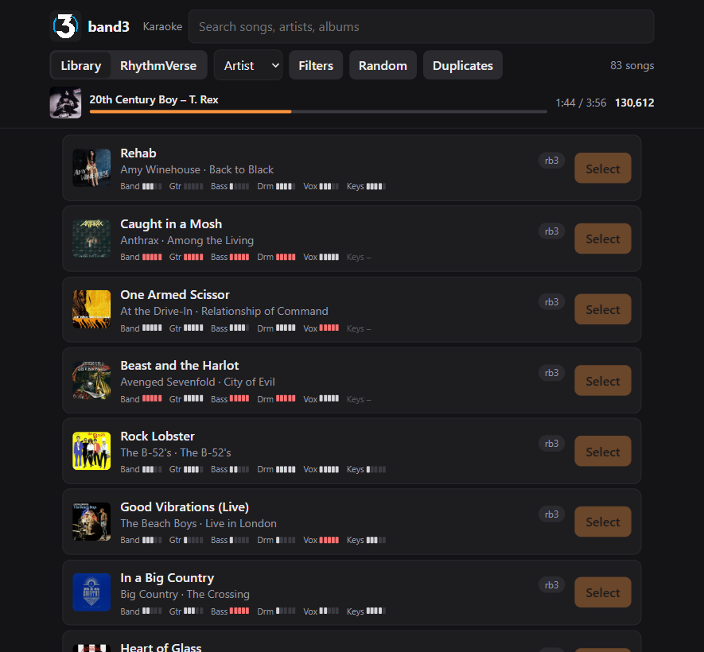
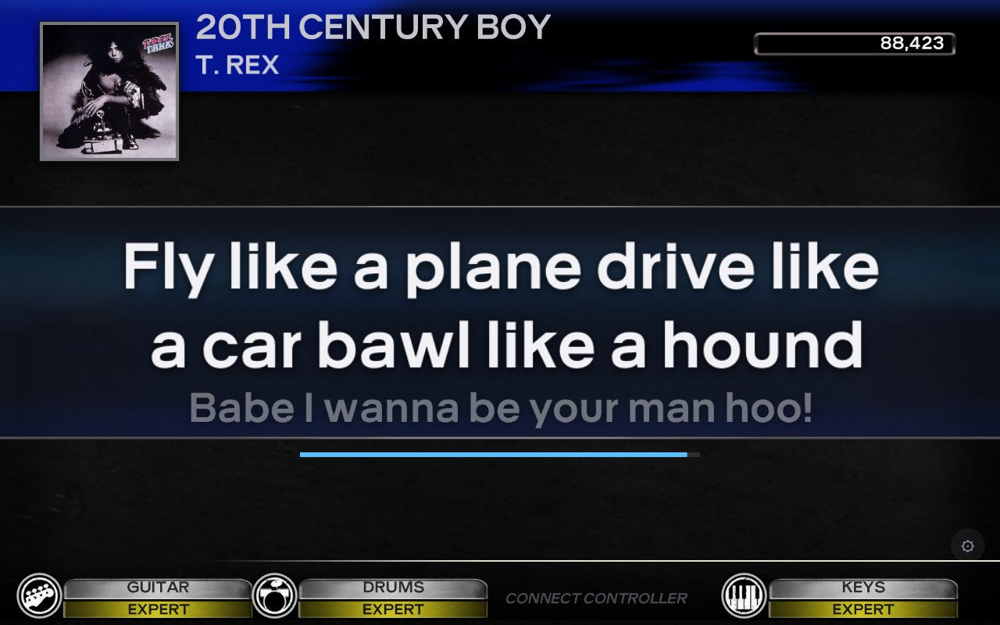

# Integrations

band3 implements much of [RB3Enhanced](https://github.com/RBEnhanced/RB3Enhanced)'s
behaviour natively, so tools and mods written for RB3E (including
[Rock Band 3 Deluxe](https://github.com/hmxmilohax/rock-band-3-deluxe)) work with it.
All of these are on the Online tab, on the launcher or in the in-game settings (in their All settings, Band3 →
Online), unless noted.

## Network events (Stage Kit, song and venue info)

Turn on `events_enabled` to send RB3Enhanced-compatible events over UDP: Stage Kit
lighting, the song, band, venue and screen, and Rock Band 3 Deluxe's
`rb3e_send_event_string` data, so existing receivers (Stage Kit lighting bridges, RB3E
dashboards) work unchanged. `events_target` is 255.255.255.255 (the local network) by
default; if receivers see nothing (common with VPN or virtual adapters), use your subnet's
broadcast address (e.g. 192.168.1.255) or one device's IP. `events_port` is 21070.
`events_target` and `events_port` need a restart.

## Stage Kit lights

band3 lights Stage Kits itself, as YARG does, so a kit needs no RB3E Dashboard or
bridge in between. The game's lighting goes to every kit band3 can reach; the
**Lights** tab (in the launcher and the in-game settings) lists them and tests them.

- **Plugged in by USB** (`stagekit_usb`, on by default): Santroller Stage Kits in HID mode
  (VID 1209, PID 2882) and Xbox 360 Stage Kits (XInput subtype 9).
  - band3 looks for them every 2 seconds, and turns them off when a song ends and when it
    closes.
  - A kit isn't a player and doesn't take a controller's place. An XInput kit does take one
    of Windows' four XInput slots, shared with Xbox 360 instruments; a Santroller kit in HID
    mode takes none.
- **Wireless, Pico W** (`pico_discovery`, on by default): the
  [RB3E Dashboard's](https://github.com/idio-sync/rb3e-stagekit-networked) Pico W firmware,
  found as the dashboard finds it (UDP 21071).
  - Picos follow the game through the network events above, so `events_enabled` must be on;
    the tab offers to turn it on.
  - A Pico answers whichever program found it last, so turn this off while the dashboard
    itself runs.
  - The tab lists each Pico's signal and whether a kit is plugged in; a quiet one shows
    offline after 10 seconds and leaves the list after 30.

The tab's test controls are the dashboard's (colours, fog, strobe, LED patterns, a chase),
for one device or all. A song's next lighting command takes over from a test.
`python tools/fake_pico.py` stands in for a Pico on this PC and prints what band3 sends it.

**Black background:** the kits' lighting comes from the venue, so with no venue (the Black
Background modifier, or `forced_venue = none`) they stay dark. **Keep the lights on a black
background** (`black_background_lights`, the Lights tab) instead puts the song in a video
venue drawn black, with the band hidden, so the kits light as usual. It costs what a venue
costs. A forced venue still wins.

## Home Assistant

band3 can tell [Home Assistant](https://www.home-assistant.io) what the game is doing,
as the RB3E Dashboard (`rb3e-stagekit-networked`) does, without running the dashboard.
It does it two ways, and you can use either or both:

- **MQTT**: band3 connects to Home Assistant's MQTT broker and shows up as a device,
  "band3 (*your PC's name*)", with entities for the song, artist, venue, score, screen,
  band and more, which Home Assistant finds by itself (MQTT discovery).
- **Webhook**: band3 POSTs the dashboard's webhook payloads when a song starts, ends or
  changes, so an automation written for the dashboard works unchanged.

Home Assistant only watches: nothing it sends changes the game. The settings are in the
Online tab's Home Assistant section, or `band3.toml`'s `ha_*` keys (`[homeassistant]` without
the `ha_` in the older `band3_config.ini`). All of them need a restart.

### Setting up MQTT

1. In Home Assistant, install the **Mosquitto broker** add-on (Settings → Add-ons → Add-on
   store) and start it, then add the **MQTT** integration (Settings → Devices & services),
   which usually finds the broker by itself.
2. Make a Home Assistant user for band3 (Settings → People → Users). The Mosquitto add-on
   accepts Home Assistant's users.
3. In band3's Online tab, set **MQTT broker** (`ha_mqtt_host`) to Home Assistant's
   address (e.g. `homeassistant.local` or `192.168.1.10`), then **User name**
   (`ha_mqtt_username`) and **Password** (`ha_mqtt_password`) to that user's. **Port**
   (`ha_mqtt_port`, 1883) and **Discovery prefix** (`ha_discovery_prefix`,
   `homeassistant`) only change if you changed them in Home Assistant.
4. Restart band3. The device appears under the MQTT integration.

The password is stored as plain text in `band3.toml`. The launcher and the in-game
settings mask it, but the SDK's own menu (the in-game settings' **All settings...**)
shows it. band3 never writes it to the log or to `/status`.

### Entities

Each entity's state is on `band3/<id>/<entity>`, where `<id>` is the PC's name in lower
case with everything but letters and digits made `_` (so two PCs can share one broker).
Home Assistant names them after the device, e.g. `sensor.band3_desktop_abc_song` on a
PC named DESKTOP-ABC.

| Entity | Kind | State |
|---|---|---|
| Song | sensor | the song's title; attributes `shortname`, `artist` and `length_ms` |
| Artist | sensor | the song's artist |
| Venue | sensor | the venue's name as the game has it |
| Score | sensor | the band's score |
| Playing | binary sensor (running) | on during a song, until you leave its results |
| Paused | binary sensor | on while the song is paused |
| Screen | sensor | the game's name for the screen that's up, e.g. `main_hub_screen` |
| Song progress | sensor | how far into the song, 0-100 %, at most once a second; attributes `position_ms` and `length_ms` |
| Band | sensor | each player's part and difficulty, e.g. `Guitar (Expert) · Drums (Hard)` |

The song, artist and score keep the last song's after it ends, and progress the point
the song ended at.

With **Stage Kit lights** (`ha_stagekit`) on, band3 also tells Home Assistant what the
game sends to a Stage Kit, as it sends it:

| Entity | Kind | State |
|---|---|---|
| Stage Kit red, yellow, green, blue | sensor | how many of the colour's 8 LEDs are lit; attribute `mask`, which ones (0-255) |
| Stage Kit strobe | sensor | `off`, or its speed, `1` to `4` |
| Stage Kit fog | binary sensor | on while the fog machine is |

These change many times a second during a song (band3 sends each at most every 50 ms), so
keep them out of Home Assistant's recorder, in `configuration.yaml`:

```yaml
recorder:
  exclude:
    entity_globs:
      - sensor.band3_*_stage_kit_*
      - binary_sensor.band3_*_stage_kit_*
```

Turning Stage Kit lights off removes these entities from Home Assistant the next time
band3 connects.

The entities are unavailable while band3 isn't running, even after a crash (the connection's
last will). Their states are retained on the broker, so a Home Assistant restart gets them
back at once.

### Connection state

The web server's `/status` has the connection's state in `ha_state` (and the
[test harness](test-harness.md)'s `state` too, unless it's `off`):

| `ha_state` | |
|---|---|
| `off` | no MQTT broker set |
| `connecting` | connecting to the broker |
| `connected` | connected; the entities are up to date |
| `retrying in N s` | the broker couldn't be reached or the connection dropped; band3 tries again at once, then 5, 10, 20 and 40 s apart, then every 60 s. Only a connection that lasted a minute starts these over, so a broker that keeps taking band3 and dropping it (another client with its id, an ACL) is retried ever more slowly too |
| `refused: <reason>` | the broker turned band3 away for a reason only a settings change mends (`bad user name or password`, `not authorized`); band3 doesn't try again until it restarts |

The log's `ha:` lines say when band3 connects, why it couldn't or the connection dropped
(once per distinct error, not on every retry), and what went wrong with the webhook.

### Webhook

Set **Webhook URL** (`ha_webhook_url`) to a Home Assistant webhook,
`http://<home assistant>:8123/api/webhook/<webhook id>`, and restart band3. It POSTs
these as JSON, as the RB3E Dashboard does:

| When | Payload |
|---|---|
| a song starts | `{"type":"state","status":"playing"}` |
| a song ends (you leave its results) | `{"type":"state","status":"menu"}` |
| the song changes | `{"type":"song","name":"<title>"}`, sent before `playing` when a song starts |

The dashboard's `HomeAssistant/rb3e_lighting.yaml` automation works unchanged with webhook
id `rb3_event`; a copy is in [home-assistant/rb3e_lighting.yaml](home-assistant/rb3e_lighting.yaml)
(it also puts the song's title in an `input_text` helper). A shorter one that dims a light
for each song:

```yaml
alias: "Rock Band 3 lights"
trigger:
  - platform: webhook
    webhook_id: "rb3_event"
    local_only: true
    allowed_methods:
      - POST
action:
  - choose:
      - conditions: "{{ trigger.json.type == 'state' and trigger.json.status == 'playing' }}"
        sequence:
          - service: light.turn_on
            target:
              entity_id: light.living_room  # your light
            data:
              brightness_pct: 30
      - conditions: "{{ trigger.json.type == 'state' and trigger.json.status == 'menu' }}"
        sequence:
          - service: light.turn_on
            target:
              entity_id: light.living_room
            data:
              brightness_pct: 100
mode: queued
```

Each POST has 2 s and isn't retried: a late "playing" is worse than none. A failure (no
answer, or a status other than 2xx) is logged once per distinct error
(`ha: webhook: HTTP 404`). The webhook doesn't need MQTT; with both set, both run.

## Discord Rich Presence

Turn on `discord_enabled` (then restart) to show the current song as Discord Rich
Presence. It talks to the Discord desktop app directly; no companion app is needed.

## Scrobbling (Last.fm, ListenBrainz)

band3 can tell [Last.fm](https://www.last.fm) and [ListenBrainz](https://listenbrainz.org)
the songs you play, in the Online tab's Scrobbling section (then restart). When a song
starts it shows as "now playing". When it ends, it's scrobbled if you played it for
half its length or 4 minutes, whichever comes first (songs of 30 seconds or less never
count). That's the time from the song's start to its end, so a song you quit early
doesn't count.

- **Last.fm**: turn on `lastfm_enabled`. On the next start, band3 opens Last.fm in your
  browser to ask whether band3 may scrobble to your account. Allow it within 10 minutes,
  and band3 saves the session it's given to band3.toml as `lastfm_session`, so you're
  asked only once. Clear `lastfm_session` to sign in again, as another Last.fm user.
- **ListenBrainz**: turn on `listenbrainz_enabled` and paste your user token from
  [listenbrainz.org/settings](https://listenbrainz.org/settings/) into
  `listenbrainz_token`.

If a service can't be reached, the listens are kept and sent again a minute later, then
at longer intervals. They're kept only while band3 runs, so listens still waiting when
you quit are lost. The log says what was sent (`Scrobbling: scrobbled 1 song to
Last.fm`) and why anything wasn't. It never shows your token or session.

Last.fm scrobbling needs band3's Last.fm API key, which builds get at configure time
(`-DBAND3_LASTFM_API_KEY=... -DBAND3_LASTFM_API_SECRET=...`). A build without it logs
that it can't scrobble to Last.fm; ListenBrainz works either way.

## Web server

Turn on `http_enabled` (then restart) and band3 serves a web page on port 21070
(`http_port`) to this PC and the local network (`http_address` 127.0.0.1 keeps it to this
PC). The log says where to open it
(`Web server: listening on 0.0.0.0:21070, open http://192.168.1.20:21070/`).



The page lists the song library with album art and part difficulties, searchable and
sortable. Windows asks once whether to let band3 through the firewall; allow it on private
networks for other devices to reach it.

- **Select** highlights a song in the game's Music Library, which has to be open.
- **Filters** narrows it by parts (keys, pro, harmonies), difficulty, genre or decade.
  **Random** picks one of the songs showing.
- A banner says what the game is doing: during a song, which, how far in, and the score.
- **Duplicates** lists songs in more than one package ([Duplicate songs](#duplicate-songs)),
  and **RhythmVerse** searches custom songs to download ([RhythmVerse](#rhythmverse)).
- **History** lists the songs you've finished, and the library sorts and filters by them
  ([Score history](#score-history)).

It answers RB3Enhanced's API, so RB3E's page and tools written for it work too:

| Endpoint | |
|---|---|
| `/` | the page; an `rb3e_index.html` at `game:\` replaces band3's |
| `/list_songs` | every song, as `[shortname]` sections of `shortname=`, `title=`, `artist=`, `album=` and `origin=` lines |
| `/song_<id>` | one song's lines, by song ID |
| `/jump?shortname=<name>` | selects the song in the Music Library: 409 when it isn't open, 404 for a shortname no song has |
| `/execute?script=<dta>` | runs a DTA script, only with `http_allow_scripts` on (anyone on the network could run any script, so it's off by default) |
| `/jsonrpc` | `discordrp.json` at `game:\`, which Rock Band 3 Deluxe writes for Discord presence tools |

band3 adds its own, which RB3E doesn't have:

| Endpoint | |
|---|---|
| `/song_details` | every listed song's `genre` (as the Music Library names it), `year`, `length_ms`, `vocal_parts`, `origin` (the game it came from, as `/list_songs` gives it) and `tiers`, the difficulty of each part it has (`band`, `guitar`, `bass`, `drum`, `vocals`, `keys`, `real_guitar`, `real_bass`, `real_keys`) from 0 (Warmup) to 6 (Impossible), as JSON by shortname |
| `/library/duplicates` | the [duplicate songs](#duplicate-songs) as JSON: `reading` (the packages are being read; ask again), `read` and `total` packages, `unreadable` (packages whose songs.dta couldn't be read), `game` (the game's own songs were compared; false while it's busy, and just after it starts, until it has loaded them) and `groups`, each a `kind` (`same_file`, `song_id`, `shortname` or `similar`), its `key` and its `copies`: `shortname`, `song_id`, `title`, `artist`, `file` (the package; empty for the game's own songs), `songs_in_file`, `size`, `in_use` and `differs` (a copy band3 left out that isn't the size of the one it loads); and `set_aside`, each a `file` and `next_launch` (not done yet) |
| `POST /library/set_aside` | sets a package aside at the next launch: `{"file": "<path>"}`, one of the report's with one song or a copy band3 left out, or `{"left_out": true}` for every such copy left out (but those of another size); 409 for anything else |
| `POST /library/put_back` | `{"file": "<path>"}`, one of the report's `set_aside`: cancels it if it's waiting for the next launch, or renames it back |
| `/status` | what the game is doing, as JSON: `screen`, `in_library` (the Music Library is open, so `/jump` can select), `ha_state` (the [Home Assistant](#connection-state) connection) and `playing`, during a song its `shortname`, `title`, `artist`, `score`, `position_ms` (null until the song starts) and `length_ms`, else null |
| `/album_art?shortname=<name>` | the song's album art as a JPEG, read as the game reads it for the Music Library (from the ARK, or a loose file that replaces it); 404 when the song has none, or no song has that shortname |
| `/rv/search?text=<text>&page=<n>` | a page of 25 of [RhythmVerse](https://rhythmverse.co)'s Rock Band 3 (Xbox) songs matching the text, or its newest without, as JSON (`total`, `page`, `page_size`, `songs`). Each song has its `file_id`, details, `tiers` (as `/song_details`), `song_id`, `download` (band3 can download it), `downloaded` (its file is in the content folders), `in_library` (null while the game is busy) and `update` (`available`, `pending` or empty). Optional: `sort=` `newest`, `updated`, `downloads`, `title`, `artist` or `length`; `downloadable=1`; `has=` parts (`keys`, `real_guitar`...); `harmonies=1`; `genre=metal,rock`; `decade=1990,2000`; `cap=<part>:<tier>` for a part's difficulty at most |
| `POST /rv/download` | downloads `{"file_id": "<id>"}` from a search into the songs folder, or with `"update": true` the newer version of one band3 downloaded: 404 for a song no search has found, 409 for one RhythmVerse doesn't host, or has nothing newer of |
| `/rv/downloads` | this session's downloads as JSON: the `folder` they go to, and each one's `state` (`queued`, `downloading`, `done`, `failed`), `received`, `total`, `error`, `song_id`, `update` and `in_library` |
| `/rv/updates` | newer versions on RhythmVerse of the songs band3 downloaded, as JSON: `checking` (a check is running), `checked` (when the last one finished, in seconds since 1970; 0 for never), `error` (why the last one failed), `downloads` (how many songs band3 has downloaded) and `updates`, songs as `/rv/search` gives them, with `update` `available`, or `pending` once downloaded |
| `POST /rv/check` | checks RhythmVerse for those updates now (send `{}` as JSON); `/rv/updates` says when it's done |
| `/history/summary` | [score history](#score-history)'s played songs as JSON: `songs` by shortname, each with `plays`, `last` (seconds since 1970) and `parts` by `<part>:<difficulty>` (`real_drum:3`), each with `plays`, `last`, `best_score`, `best_stars` (6 is gold) and `best_pct`, the bests from runs that count (0 when none does). `{"enabled": false}` with `score_history` off, as for all three |
| `/history/runs?shortname=<name>` | that song's runs, newest first, as JSON (`runs`): each with `t`, `shortname`, `song_id`, `title`, `artist`, `part`, `diff` (0 easy to 3 expert), `score`, `stars`, `pct`, `streak`, `od_deploys`, `solo_pct` and `unison` (when the part has them), `band_size`, `speed` (percent), `modifiers`, `autoplay` (harness runs only) and `counts` (toward bests). Optional: `part=`, `diff=` |
| `/history/recent?limit=<n>` | the last runs across all songs, newest first, as `/history/runs` gives them (50 by default, 500 at most) |

- `http_allow_cors` adds `Access-Control-Allow-Origin: *`, for pages served from elsewhere.
- Requests wait for the game's next frame, and get a 503 if it doesn't come within 5 s.
- Files at `game:\` are found as the game finds them: the user data root's `game` folder
  ([Folders](settings.md#folders)) first, then the game data root.

**Working on the page:** `python tools/web_preview.py` serves it without the game at
http://127.0.0.1:21080/, with songs read from the game data. It reloads `src/Net/http_page.h`
on every request, so edits show on a refresh. **Select** can't work there, `--status` (`menu`,
`library` or `playing`) sets what `/status` says, and RhythmVerse downloads and updates are
made up, as is the score history.

### Score history

With `score_history` on (the default), band3 keeps each player's results whenever a song is
finished: score, stars, notes hit, longest streak, overdrive deploys, solo and unison
results, the part and difficulty, the song's speed and the modifiers on. They're kept in
`score_history.jsonl` in the user data folder, one run a line, for every player, guests
included. A song quit or failed isn't kept, nor one played on autoplay.

- The web page's **History** tab lists the latest runs; a song's details show its best per
  part, its score over time and every run.
- The library sorts by **Last played**, **Most played** and **Least played**, and **Filters**
  gains **Never played**, **Played**, **Not gold-starred**, **Not played in 30 days** and a
  best-stars cap, judged on a part and difficulty you pick, or any.
- Bests count only runs at full speed without modifiers (No Fail, and RB3Enhanced's Force
  HOPOs, Mirror Mode, the shuffles and Double Bass Pedal); slowed or modified runs still count
  as plays.
- The test harness never writes to it: a harness session keeps its runs, autoplay ones
  included, in `test_score_history`'s file if one is set (`tools/score_history_check.py`).

### Karaoke and live pages

`/karaoke` is a sing-along page for a screen facing the room, linked from the library page's
header. It shows the line being sung and the next, each syllable filling as it's sung, with
harmonies stacked and overdrive phrases on the gold lane, under a header with the band's
score. Between songs it shows the song's album art, genre, year and parts.



- Its corner button sets the timing (for a TV's delay) and the text size, kept in that
  browser.
- A page over plain http can't keep a device awake, so turn the device's sleep off.
- It's drawn in the game's own font and menu art, read from your game files; band3 ships none
  of it. Where an asset can't be read it falls back to a plain look. The header's glass needs
  Rock Band 3 Deluxe's copy of its normal map.

Other pages can use the same endpoints, served only on your network:

| Endpoint | |
|---|---|
| `/game_asset/texture?path=` | a texture the game keeps as a file of its own (a `.png_xbox` or `.bmp_xbox` under `ui/` or `dx/`, such as `ui/image/gen/dx_blank_album_art_keep.png_xbox`) as a PNG; 404 for any other path or a format band3 doesn't decode |
| `/game_asset/font?name=` | a font in `ui/resource/fonts/gen/` (`pentatonic`, `pentatonic_bold`, `gangly`...): `{"cell": [w, h], "texture": [w, h], "base_kerning", "monospace", "glyphs": {"<character code>": [u, v, width, advance]}, "kerning": [[left, right, kerning]]}`; a glyph is at (u × texture width, v × texture height), width × cell width across and the cell's height down; widths, advances and kerning are in cell widths |
| `/game_asset/font.png?name=` | that font's texture: white, the glyphs in its alpha |
| `/game_asset/milo_texture?milo=&name=` | a texture inside one of the game's UI milos (`milo` a `.milo_xbox` under `ui/`, such as `ui/track/gen/track_shared.milo_xbox`; `name` the file its Tex records, such as `lyrics_bg_blue.png`) as a PNG; 404 for any other milo or name, a texture that isn't there, or a format band3 doesn't decode (the menus' BC5 normal maps); 503 while the game is busy |
| `/lyrics?shortname=` | the song's lyrics from its MIDI file: `{"shortname", "parts": [{"part": "lead" \| "harm1" \| "harm2" \| "harm3", "lines": [{"start_ms", "end_ms", "overdrive", "syllables": [{"start_ms", "end_ms", "text", "join", "spoken"}]}]}]}` (`overdrive`: an overdrive phrase covers the line, PART VOCALS' for the lead, HARM1's for the harmonies); 404 for a song without vocals, 503 while the game is busy |
| `/live/events` | server-sent events: `state` (`screen`, `in_game`, `paused`, `song` {`shortname`, `title`, `artist`, `length_ms`} or null, `vocals` `none` \| `lead` \| `harmonies`, `band`: four slots, each null or {`part` (as `/song_details` names parts), `difficulty` as the game gives it, 0 easy to 3 expert}) whenever it changes, and `clock` (`song_ms`, the game's song clock; `score`, the band's) four times a second during a song. Four streams at once: a fifth takes the place of the one open longest (a device asleep can keep its connection open), which gets `evicted` and stops; its page offers a tap to follow the game again |

`tools/web_preview.py` serves `/karaoke` without the game, over a made-up show
(`--karaoke-song <shortname>` for a song's own lyrics, `--vocals harmonies`).

### Duplicate songs

The same song often ends up in more than one package: a single and a pack, two versions
of a chart, a download and a copy made by hand. The Library tab's **Duplicates** reads
the `songs.dta` of every package band3 has (in the background, the first time, then only
new and changed packages; band3 keeps what it read in `band3_package_songs.json` in the
user data root) and lists four kinds:

- **Same file**: copies of one package, in two folders or under two names. Its content ID
  hashes its header and, through it, its contents, so band3 loads only the first it finds
  and the rest only take up space. A copy that isn't the size of the one loaded says
  **Another size**: look before setting it aside.
- **Same song ID**: the game takes the first of these it loads, in band3's order (the
  content folders' order, then by file name), and leaves the rest out without a word.
  The one it has is **In use**, the rest **Left out**.
- **Same shortname**, with different song IDs: the game has them all, but what finds a
  song by its shortname, as **Select** does, finds only one. A custom song that takes a
  disc song's shortname shows here too.
- **Same artist and title**, by letters and digits: other charts of the same song, maybe,
  which the game has all of.

**Set aside** takes a copy out. Nothing is deleted:

- At band3's next start the file is renamed to end in `.setaside`, which band3 passes over.
  Until then a `<name>.setaside-next` beside it marks it.
- Only a single-song package can be set aside, never a pack or the game's own songs. The
  exception is a **Same file** copy band3 already leaves out, pack or not.
- **Set aside the left-out copies** does it for every copy already left out (not those of
  another size), so nothing changes in the game. Setting aside the **In use** copy lets the
  next one take its place.
- What's set aside is listed at the end, with **Cancel** (before the next launch) and **Put
  back**. A RhythmVerse song shows **Download** again once set aside.

### RhythmVerse

The page's **RhythmVerse** tab searches [RhythmVerse](https://rhythmverse.co)'s custom
songs for Rock Band 3 on Xbox, with sorting and **Filters** (parts, difficulty, genre, decade,
and **Downloadable only**, on at first). Each song says whether you have it, however you got
it:

| Status | Means |
|---|---|
| **In library** | the game has a song with its song ID; **Select** selects it in the Music Library |
| **Downloaded** | its file is in the content folders, under RhythmVerse's name and size |
| **Not in game yet** | downloaded, but the game hasn't taken it in yet |
| **Similar in library** | a song with its artist and title is in the game, maybe another chart |

**Download** saves the package into `rhythmverse` in the first content folder
(`songs\rhythmverse` by default). The game takes it in without a restart, as it took in Xbox
store purchases: at once with the Music Library open, otherwise after the current song or on
the way into the Music Library. Songs copied in by hand join the same way once a search has
seen them.

- **Downloads directly:** songs RhythmVerse hosts, and links to a file on MediaFire, Google
  Drive, Dropbox or dingorb (also through bit.ly or tinyurl).
- **Opens the RhythmVerse page instead:** mega.nz, Drive folders, zipped uploads and official
  DLC.
- A download that isn't a Rock Band package is thrown away.

**Updates:** band3 checks the songs it downloaded half a minute after it starts (at most every
12 hours), or when you press **Check for updates**. Songs with a newer version are listed at
the top with **Update** and **Update all**.

- An update downloads beside the old file as `<name>.pending` and replaces it at band3's next
  start, keeping the old one as `<name>.replaced`. Nothing is deleted.
- Songs from other sites mostly have no hashes, so editing only a song's RhythmVerse page can
  show an update too.
- Songs you got some other way aren't checked.

Turn `http_rhythmverse` off (`[http] rhythmverse = false`) to leave the tab out. RhythmVerse's
API isn't documented, so a change on its side can break the tab until band3 follows.

## GoCentral (Rock Central)

Rock Band 3's online features (leaderboards, Battles, setlists shared with friends,
Rock Central's goals) talked to Harmonix's Rock Central, which closed.
[GoCentral](https://github.com/ihatecompvir/GoCentral) is a fan-run replacement that
RB3Enhanced players use. On the Online tab, set `username` (the Game tab's Profile name)
to a name of your own, turn on `gocentral`, then restart; or do it on the
[launcher](settings.md#the-launcher)'s Game and Online tabs and press Play. band3 then logs into
`gocentral_address`, RB3Enhanced's Xbox 360 server (`gocentral-xbox.rbenhanced.rocks`)
unless you run your own, as RB3Enhanced does on a console with Xbox Live blocked.

GoCentral knows Xbox players by their name alone, with no password: anyone using
your name logs in as you. band3 won't connect while `username` is blank or "User",
every profile's name until you change it.

To see how a connection goes, turn on `log_net_calls` (the in-game settings' Advanced tab, Logging): the log then
has each of the game's network calls and each step of its Rock Central login.

## Liveless (online play)

Rock Band 3 plays online over Xbox Live, which band3 doesn't have. Like RB3Enhanced's
Liveless, band3 plays straight from one player's game to another's, so band3 players can play
together (and probably with RB3Enhanced players, untested), on Windows or Linux: two games on a
Steam Deck have played a song together through Liveless Rooms. Only play on one PC and on a
local network has been tested so far.

**Setup:** turn on `liveless` (Online tab), set `username` (the Game tab's Profile name) to
the name others will see, then restart, or press Play on the [launcher](settings.md#the-launcher).

**Playing:**

1. The host leaves `liveless_connect` at `127.0.0.1`. Each joining player sets it to the
   host's address: the local one on the same network, the public one over the internet.
   To join by code instead, see [Liveless Rooms](#liveless-rooms-joining-by-code).
2. Everyone presses Start for the overshell, picks **Play on Xbox Live**, backs out, then
   picks Play Now → Quickplay → **Find Xbox Live Players**. The host has to search too, or
   joining players are turned away.
3. Once the others show in the host's band, the host picks **Play With Current Lineup**.

There's no lobby: a search finds only the game at `liveless_connect`. Over the internet each
player needs `liveless_port` (UDP 9103) forwarded to their PC, which band3 asks the router
for ([Port mapping](#port-mapping)). `liveless_port` can also move the game to another port,
so two band3s on one PC can play each other, as [`tests/game/liveless.b3t`](../tests/game/liveless.b3t)
does.

### Port mapping

With `liveless` on, band3 asks the router to forward `liveless_port` to this PC (PCP, then
NAT-PMP, then UPnP), as RB3Enhanced does, and tells joining players the public address the
router reports. The mapping lasts an hour, is renewed every half hour, and is deleted when
band3 closes. Turn `liveless_port_mapping` off (Online → More settings, then restart) to leave
the router alone.

The log's `port mapping:` lines and the Rooms panel (F10) show how it went, e.g. `UDP 9103:
mapped by PCP, public 203.0.113.5` or `not mapped:` and why.

**If it doesn't work:**

- band3 asks only as it starts. If the router or network came up later, restart band3.
- Not mapped: forward the port by hand and set `liveless_external_ip` to your public IP.
- A router can forward a port to only one PC, so two PCs behind one router can't both use 9103.
- A router behind another router (a private address such as 192.168.x or 100.64-127.x) still
  forwards, but band3 doesn't hand out that address.
- The forward doesn't open Windows Firewall: if you declined its prompt, allow band3.exe for
  UDP in Windows Security → Firewall & network protection → Allow an app through firewall.
- After a crash, a mapping can linger until it lapses or band3's next start clears it. band3
  leaves alone a mapping of the port to another PC or program, and logs whose it is.

The public address band3 hands out comes from, in order: `liveless_external_ip`, the Rooms
server, the router, then this PC's local address.

### Liveless Rooms (joining by code)

RB3Enhanced's Liveless Rooms joins players by a room code instead of an address: each game
logs in to a Rooms server and gets a code, and the server tells joining players where the
host's game is.

**Setup:** turn on `liveless` and `liveless_rooms` (Online → More settings), set `username`
(the Game tab), then restart. band3 logs in to `liveless_rooms_server`, RB3Enhanced's
(`liveless-testing.ipg.pw`) unless you run your own. As with GoCentral, the server knows you by
your name alone, so band3 won't log in while it's blank or "User".

**The Rooms panel** shows your code, the server, the connection's state and the last error.
Open it with **F10** (`bind_liveless_rooms`), or once online with **Xbox Live Options** →
**Invite Friends** in the overshell. Give your code to the players who'll join you. Codes are 1-8
letters and digits in either case; the public server gives five.

If the connection drops, band3 reconnects by itself (5 s, then 10, 30 and 60 s apart); **Connect**
tries now. It doesn't retry when the server refused the login: that needs a fix on your side.

To join someone:

1. Go online first: press Start for the overshell, pick **Play on Xbox Live**, then
   back out of it. Until then, and again once the game leaves Xbox Live, the panel's
   **Join** stays greyed out ("Go online first: Play on Xbox Live in the overshell.").
2. Open the panel, enter the host's code (type it, or pick its characters from the
   grid under the field) and press **Join** (or Enter in the field).
3. Your game joins the host's band, as when accepting an invite on a console. Then
   you both pick the same mode: Play Now → Quickplay → **Choose Songs**. The host waits
   ("Waiting for Xbox LIVE Players...") until the player who joined picks it too.

- **With a controller:** the d-pad moves around the panel, A presses, X deletes a character
  and B closes it. The game reads no buttons while the panel is in front.
- **Ports:** joins by code always go to UDP 9103, as RB3Enhanced's do, so the host keeps
  `liveless_port` at 9103 (the panel warns otherwise), forwarded by band3
  ([Port mapping](#port-mapping)) or by hand. `liveless_external_ip` isn't needed: the server
  supplies the public address. Players behind the same public address join over the local
  network.

What the panel's errors mean (✓: band3 connects again by itself, as above):

| Error | | |
|---|---|---|
| `no IPv4 address for <server>` | `liveless_rooms_server` didn't resolve: check it and the PC's connection | ✓ |
| `no answer from <server>`, `<server> refused the connection` | nothing is taking connections at that address (port 19532 unless it has `:port`), or a firewall is in the way | ✓ |
| `the server turned the connection away` | the server isn't taking this client | |
| `login refused: check that liveless_rooms_server matches the server's address, and username` | the server closed the connection before giving a code. It checks the login against its own name, so `liveless_rooms_server` must be that name as the server knows it (not, say, its IP address): fix the setting and restart | |
| `the server closed the connection` | the connection went after logging in; the code may change | ✓ |
| `the server stopped answering` | the server sent nothing for 30 s | ✓ |
| `bad data from the server` | the server sent something band3 can't read. Before logging in, the address isn't a Rooms server | ✓ after logging in |
| `not logged in to the Rooms server` | a join before the code came, or after the connection went | |
| `the game isn't online yet: Play on Xbox Live first` | a join while the game is offline: before Play on Xbox Live, or after leaving it |
| `a code is 1-8 letters and digits` | the code is empty, longer than eight characters, or contains something other than ASCII letters and digits |
| `no game with code <code>` | no one is logged in with that code: check it with the host, whose game must be running with Rooms on |
| `join denied (reason <n>)` | the server turned the join away for a reason band3 doesn't know |
| `the server gave no address for <user>` | the server found the host but gave no address to reach them at |

The log's `rooms:` lines follow the connection: logging in, with the code and public
address, and what each join did.

## RB3Enhanced compatibility

### Script functions

band3 gives the game's scripts RB3Enhanced's functions, so mods written for RB3E (Rock
Band 3 Deluxe among them) can call them: `rb3e_get_song_name`, `rb3e_get_artist`,
`rb3e_get_album`, `rb3e_get_genre` and `rb3e_get_origin` (each takes a song ID),
`rb3e_get_song_count`, `rb3e_set_venue` (for this session; `forced_venue` keeps its
value), `rb3e_local_ip`, `rb3e_api_version` (1, the RB3E API band3 follows),
`rb3e_build_tag` (`band3 <build>`), `rb3e_commit`, `rb3e_is_emulator` (1), `rb3e_send_event_string`,
`rb3e_change_music_speed`, `rb3e_change_track_speed` and their `rb3e_get_` pairs (the
`song_speed` and `track_speed` settings, for this session) and
`print_debug`, which logs its argument. API 1's queries read the song being played:
`rb3e_get_track_count`, `rb3e_get_track_type` (takes a track index) and
`rb3e_has_track_type` (a track type), and, for a track type and difficulty,
`rb3e_get_game_gem_count`, then for a gem of that list `rb3e_get_game_gem_time_ms`,
`rb3e_get_game_gem_time_tick` (a 5th argument of 1 gives when the gem's sustain ends)
and `rb3e_get_game_gem_slots`. 22-fret pro guitar and bass find the 17-fret track, as
on RB3E. Outside a song they give -1, and `rb3e_has_track_type` 0.
`rb3e_relaunch_game` starts band3 again with the same command line (a minimized test run
stays minimized; the new one waits for this one to close) and closes this one. `rb3e_delete_songcache` deletes the song cache the
game mounted (`songcache`, or Deluxe's `rbdxcache`, in the user data root) the next
time band3 starts, since the game has it open. With `http_allow_scripts` on, the web
server's `/execute` runs them, e.g. `{print_debug {rb3e_get_song_name 1009}}`.

### Rock Band 3 Deluxe

Rock Band 3 Deluxe only uses those functions when its scripts see `RB3E` defined, as
RB3E's loader does. With `rb3e_mode` (on unless you turn it off, then restart) band3
defines `RB3E` and `RB3E_HAS_VERSION`: Deluxe then shows its RB3E version line, offers its
party mode (which shows this PC's address for the web page above) and looks songs up
through these functions, and its "Clear and reboot game" after a Deluxe update clears the
song cache and restarts band3.

Deluxe checks `rb3e_api_version` first and, if it isn't the version it expects, says at
every start that RB3Enhanced needs updating and leaves those features off. band3
answers 1, as RB3E's nightlies have since 2026-10-11; Deluxe builds from before then
expect 0, so on those the prompt means Deluxe needs updating, not band3.

### Modifiers and options

band3 also adds RB3E's six modifiers to the game's (Options → Modifiers, and Deluxe's
menus), with or without `rb3e_mode`: Black Background (no venue), Force HOPOs, Mirror
Mode (green and orange, red and blue swapped), Gem Color Shuffle (gems drawn in random
colours), Gem Shuffle (each chord's lanes shuffled) and Double Bass (expert drums play
the 2x bass pedal notes).

As with RB3E, keys on guitar is always unlocked: the overshell's part list offers keys to
a guitar without the career unlock. (RB3E's other always-on patches are already in: the
8000-song limit, and the song blacklist, whose check TU5 itself no longer makes.)

Two of RB3E's options are settings too (the Game tab, both off by default):
`unlock_clothing` unlocks every piece of clothing, tattoo and face paint and the video
venues without earning them, and `gold_on_all_difficulties` lets gold stars be earned
below expert, from the next song.

### Song source icons

As RB3E does (its `GameOriginIcons`), band3 shows an icon at the left of each song in
the song list for the game or pack the song came from: Rock Band 3, Rock Band 2, The
Beatles, a track pack, customs and so on, from the song's `game_origin`. It's on unless
`game_origin_icons` (the Game tab) is off, and needs two things band3 doesn't ship:

- the icons, `ui/resource/game_origins/<origin>.png`, which Rock Band 3 Deluxe has (over
  a hundred of them). A song whose origin has no icon shows none.
- a song list with a mesh slot named `game_origin_icon` in its rows, which neither the
  game's nor Deluxe's has yet. RB3E's edit of the game's
  `ui/resource/list/gen/list_song_select_browser.milo_xbox` adds one; put it in the game
  data folder at that path, as a [loose file](settings.md#loose-files-mods).

The log says how many origins' icons it loaded each time the song list opens, and with
`log_level = debug`, the slots the loaded song list has. Turning the setting off takes the
icons away the next time the list redraws.
