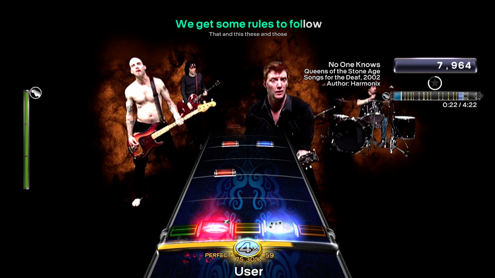

# Settings, folders and songs

## The launcher

The launcher is band3's setup screen, laid out like Rock Band 3's own menus. It opens in the
game window before the game starts, on a menu of **Play**, **Settings**, **Music Videos**,
**Test Controllers** and **Quit**. A card beside it says whether Rock Band 3 was found and
where, which Rock Band 3 Deluxe it has, how many songs there are, the controllers connected
and the last song played. While the game data folder doesn't hold the game, [Find Rock Band
3](#find-rock-band-3) comes first and Play is greyed out; Play then asks first.

**Controls:** the d-pad, left stick or arrow keys move, A (Enter) picks, B (Esc) goes back,
and Start (F5) plays from any screen. A guitar's frets and a kit's pads act as the face
buttons (green is A, red is B), and strumming moves up and down. The mouse works too: a click
picks, a right click goes back. The bar along the bottom says what each button does, and its
items can be clicked.

### Settings

**Settings** has twelve categories: Game, Gameplay, Display, Graphics, Audio, Controllers,
MIDI, Music Videos, Lights, Online, Other Apps and Advanced. LB and RB (Shift+Tab and Tab)
switch category, and the panel on the right says what the setting picked does.

- Changes apply as you make them, and leaving Settings saves them ([What it
  saves](#what-it-saves)).
- Each category counts its settings that differ from their defaults, and a changed setting
  has an orange dot. Y (R) puts it back to its default.
- X (/) searches every category for a setting, by its name or what it does.
- Text (a name, an address) is typed on an on-screen keyboard in the panel; a keyboard
  plugged in types too.
- Devices (mics, MIDI ports, monitors) are picked from lists of what's connected. A saved
  device that isn't plugged in shows as "(not connected)" and stays chosen; **Type one...**
  takes a typed name or part of one.
- A setting given on the command line or by a `REX_*` environment variable is shown locked,
  since a saved value wouldn't win over it.

Some of the categories:

- **Game** has the folders (**Game data folder** opens Find Rock Band 3), the profile, and
  **Startup**, with **Open the launcher at startup** ([When it opens](#when-it-opens)).
- **Display** has the window's settings, and **Smoothness** the ones that trade lag ([Playing
  with the least lag](#playing-with-the-least-lag)).
  - **Fill the window** (on by default) draws the game at the window's shape with the native
    renderer, with no black bars ([details](native-renderer.md#filling-the-window)).
  - **Picture shape** (keep 16:9 or stretch) applies to the game's 16:9 picture: the emulated
    GPU's, or the native renderer's with Fill the window off.
  - On a Steam Deck, **Steam Deck settings** turns `steam_deck_defaults` on and off: on, the
    [Deck's settings](#steam-deck) are the defaults and what you change wins over them.
- **Graphics** starts with **Renderer**: Native (the default on Windows and on a Steam Deck),
  Emulated (the default on other Linux machines) or Both (debug). A change to or from Native
  restarts band3 at Play. The category shows only the rows the chosen renderer uses ([which
  settings apply](native-renderer.md#which-settings-apply)).
  - **Render size cap** caps the lines the native renderer draws, for a GPU that can't keep up
    at the window's size.
  - **VSync** shows only with the frame rate cap off, since the cap turns it off.
- **Audio** lists the PC's microphones for each mic slot, with a level meter beside each.
- **Controllers** has what gamepads and guitars play as, the menus (the mouse, typing to
  search, the stick-click shortcut), the sticks and the delay per controller type; **MIDI** has
  MIDI drum kits and keyboards. Settings apply at once, except **Controller reading**
  (`input_backend`, SDL or XInput), which restarts band3 at Play (not under the [test
  harness](test-harness.md)). **Test controllers** opens the [Test
  Controllers](#test-controllers) screen.
- **Music Videos** has the [music videos](#music-videos)' settings; **Videos and syncing**
  opens the Music Videos screen.
- **Lights** has the [Stage Kits](integrations.md#stage-kit-lights)' settings, and **Try the
  lights** tests them.
- **Online** and **Other Apps** turn on online play, GoCentral, the web song browser,
  scrobbling, RB3Enhanced's events, Home Assistant and Discord ([Integrations](integrations.md)).
  They're read as the game starts, so Play applies them without a restart.
- **Advanced** lists band3's technical settings by group (Game code, Graphics, Logging,
  Memory (the heap sizes), Native renderer, Scrobbling, Startup and Test harness), named as in
  `band3.toml`. The ones only the command line sets are shown, but can't be changed there.

### Test Controllers

**Test Controllers** lists every controller and instrument band3 sees, with Rock Band 3's
instrument icons and which player each one is, and draws the one picked live: frets, strum,
whammy and tilt; pads and cymbals flashing as hard as they're hit; a keytar's keys; buttons and
sticks, and what "Gamepads play as" makes it. A tests one on its own: its buttons only light the
drawing and don't move the menu, until Back is pressed on it (or B on another controller, or
Esc). It reads devices through band3's own drivers, so what it shows is what the game will read.

### Find Rock Band 3

**Find Rock Band 3** searches this PC's drives for the game's folder (one holding
`gen/main_xbox.hdr`) and lists the copies it finds, then the drives, to browse folder by folder
with a controller. A uses the folder picked, B goes up a level, and Y searches again; **Choose a
folder in a window...** opens the system's folder window instead.

### When it opens

- the first time band3 starts, including after updating to a version that has it;
- when the game data folder doesn't look like Rock Band 3's (the menu's card says where it
  looked);
- when Shift is held as band3 starts (Windows only), or with `--launcher`;
- otherwise only if **Open the launcher at startup** (Settings > Game) was on when the settings
  were last saved. It starts off, so after the first Play band3 goes straight into the game.

It never opens when RB3E's `rb3e_relaunch_game` restarts the game, nor for a [test
harness](test-harness.md) run unless started with `--launcher`. To get it back, hold Shift,
start with `--launcher`, or turn on **Open the launcher at startup** in the in-game settings. On
a Steam Deck in Game Mode, add `--launcher` to band3's launch options in Steam for one start.

### What it saves

Leaving Settings, or Play, saves to `band3.toml` beside the executable: only the settings that
differ from their default, plus **Open the launcher at startup**, keeping the file's other lines.
Folders inside the install are saved as relative paths, so the install still moves as one
folder.

- It doesn't keep comments: saving over a `band3.toml` with comments, or one it couldn't read,
  keeps the old file as `band3.toml.bak`.
- If `band3.toml` can't be written, a box says why and offers to try again or to keep the
  settings as they are for that session only.
- **Quit** asks first if something isn't saved.

## Playing with the least lag

Rock Band 3 judges each hit on the game's frames, so the game's frame rate, not the display's,
sets how finely hits are timed: within 16.7 ms at 60 fps, 8.3 ms at 120 and 4.2 ms at 240.
Settings > Display > **Smoothness** has the settings that trade lag:

- **Frame rate cap** (`frame_cap`) paces the game, up to 240, and can run it faster than the
  display: each refresh then shows the newest frame, so a higher cap also means a fresher
  picture.
- **Smooth frame pacing** (`native_present_pacing`, native renderer, on by default) hands each
  frame to the window a steady delay after it's made, so motion steps evenly. Off is about 3 to
  4 ms sooner at 120 fps, with the occasional uneven step. It only holds frames with the cap
  under 1.5 times the display's refresh rate and not `auto`.
- **Lowest delay** sets the cap to the most whole refreshes' worth of frames up to 240 (240
  on a 60 or 120 Hz display, 144 on a 144 Hz one), and over 160 Hz turns smooth frame pacing
  off too; Y (R) then undoes it. If the game can't hold that rate, lower the cap.

The **FPS counter** (`debug_overlay`) shows the game's frame rate (**Game**), the window's
(**Window**, held back by the display's refresh rate), and with the native renderer **Frame to
window**, how long a frame waits before it's shown. On a 60 Hz display that wait was 12.6 ms at
a 120 cap with smooth frame pacing, 9.0 ms without, and 7 to 8 ms at 240.

After changing any of these, run the game's calibration again (in its Options).

## Pause menu and in-game settings

Press **Escape**, or hold both stick clicks on a controller for a second, to open band3's pause
menu, a box over the game like Rock Band 3's: **Resume**, **Settings**, **Instrument Lab** and
**Quit Game**.

- During a song it pauses the song too, with the song's own pause menu underneath; **Resume**
  (or Escape, B or Start) resumes it. In the first couple of seconds of a song, before the game
  takes a pause, the menu opens over the song as it plays.
- In the game's menus nothing is paused, but the game reads no input while the menu is open.
- **Instrument Lab** opens the [Instrument Lab](instruments.md#instrument-lab), leaving a song
  paused. **Quit Game** asks, then closes band3.

| Shortcut | Opens |
|---|---|
| Escape (`bind_pause_menu`) | the pause menu; not while the launcher shows |
| both stick clicks, held a second | the pause menu |
| both stick clicks and LB, held a second | the [Instrument Lab](instruments.md#instrument-lab) |

The same chords close them. They work with either input backend once the game is running, from
a controller connected as a player; instruments don't count, since their solo frets and pads
send stick clicks too. `menu_shortcut` (**Stick-click shortcut**, Settings > Controllers >
Menus) turns them off.

### Settings in game

**Settings** opens the launcher's [Settings](#settings) screen over the dimmed game, with the
same categories and controls. While it's open the game gets no input; B or Escape goes back to
the pause menu, and Start straight back to the game.

- Changes apply as you make them, or from the next time the game loads what they affect. A row
  that needs a restart says **Applies when band3 restarts**: most of Online and Other Apps,
  the instrument drivers, the input backend, the microphones, the emulated GPU's
  anti-aliasing, and the renderer to or from Native. Leaving Settings with such changes opens a
  box listing them.
- The folders the game took as it started are locked: **Change this from the launcher**.
- Leaving Settings saves `band3.toml` as the launcher does. If it can't, a box offers to try
  again or to keep the changes until band3 closes.
- Not here, since the game is using the devices: Test Controllers (use the Instrument Lab, F6)
  and the mic level meters. **Videos and syncing** (Music Videos) opens the Music Videos screen
  over the game.
- **Every SDK setting** (Advanced) opens the SDK's own menu, with every setting by category
  (band3's under **Band3**) and the key binds. Its **Save to config** writes `band3.toml`
  differently from band3's settings ([below](#config-files)).

## Config files

`band3.toml` next to the executable holds band3's settings; the launcher and the in-game
settings write it. Any setting can also be passed on the command line (`--forced_venue=arena_04`)
or by a `REX_*` environment variable. The [settings reference](settings-reference.md) lists
every one, with its default and what it does, generated from the build.

Prefer band3's own saving (leaving Settings, or Play) to the SDK menu's **Save to config**.
That one rewrites the whole file with every setting that differs from the SDK's default,
whatever set it, freezing in values from `band3_config.ini`, the Steam Deck and the command
line, and drops anything else in the file.

`band3_config.ini` is the settings file from before `band3.toml`. band3 still reads it (in its
working directory, then beside the executable), but releases no longer include it and it has
only [some of the settings](settings-reference.md#band3_configini). It also marks the folder
that relative paths start from ([Folders](#folders)). Where a setting is set in more than one
place, the first of these wins:

1. the command line
2. `REX_*` environment variables
3. `band3.toml`
4. the [Steam Deck](#steam-deck) settings, on a Deck
5. `band3_config.ini`
6. the defaults

Settings worth knowing about:

- `frame_cap` ([Display](settings-reference.md#display)), `background_fps`
  ([Graphics](settings-reference.md#graphics)) and `video_mode_refresh_rate` ([the
  SDK's](settings-reference.md#more-of-the-sdks-settings)): pace the game and its venues.
- `forced_venue`, `song_speed`, `track_speed` ([Gameplay](settings-reference.md#gameplay)).
- `controller_type`, `input_backend` ([Controllers](settings-reference.md#controllers)).
- RB3Enhanced's `unlock_clothing` and `gold_on_all_difficulties`
  ([Integrations](integrations.md#rb3enhanced-compatibility)), and `game_origin_icons` ([Song
  source icons](integrations.md#song-source-icons)).

## Folders

| Setting | Default | Holds |
|---|---|---|
| `game_data_root` | `assets` | the game's files; never written |
| `user_data_root` | `Documents\band3` | saves, profiles and the `game` folder |
| `cache_root` | `cache` in the user data folder | the shader cache |

Set them on the launcher (Settings > Game), in `band3.toml` or in `band3_config.ini`. A relative path
is relative to the ini's folder, or the executable's without one, so `user_data_root =
user_data` makes a portable install.

Files the game writes to its own folder (`game:\`) go to `game` in the user data root. Rock Band
3 Deluxe keeps its settings, modifiers and playlists there (`dx_settings.dta` and so on), so
deleting that folder resets them. Test runs have their own user data.

## DLC and custom songs

band3 reads DLC and custom songs (Xbox 360 `CON`, `LIVE` and `PIRS` packages, Rock Band and
Rock Band 2 DLC included) straight from the folders `content_folders` names (Settings > Game;
`songs` beside the ini by default). Nothing is installed or unpacked, and band3 never writes
there.

- Separate folders with `|`. Subfolders count, and relative folders work as above.
- Changes apply at the next launch, except songs the web page's
  [RhythmVerse](integrations.md#rhythmverse) tab downloads or finds, which the game takes in as
  it runs. A song taken out stays listed until the next launch.
- A local folder is safer and faster than a network one: songs stream from their package as
  they play, and a library that takes over a minute to read isn't listed that session.
- A custom song whose `song_id` is text gets the number RB3Enhanced gives it (the text's CRC-32
  mod 9999999, plus 2130000000), so IDs agree with RB3Enhanced's.

## Music videos



With `music_videos` on (the default), a song's own music video plays in the video venues in
place of their background clips, in time with the song, through pauses, restarts and practice
sections. Put the video in the `videos` folder beside the ini (or `music_videos_folder`), named
after the song's shortname: `20thcenturyboy.mp4` for 20th Century Boy. The log names the
shortname as a song starts (`No music video for 20thcenturyboy in music_videos_folder`).

| Setting (Settings > Music Videos) | Default | |
|---|---|---|
| `music_video_venue_chance` | `100` | how often, in percent, a song with a video goes to one of the seven video venues: 100 (always), 75, 50, 25, or 0 to leave the venue to the game. A forced venue and the Black Background modifier win. `forced_venue = video` puts every song in a video venue |
| `music_video_hide_band` | on | the band isn't drawn while a video plays; cameras, lights and [Stage Kits](integrations.md#stage-kit-lights) go on as before |
| `music_video_as_is` | on | the venue's colour filter, film grain, glow and trails are left off, so the video looks as it does in a player |
| `music_video_full_rate` | on | a 60 fps video plays at 60 fps, drawing the venue that fast (up to the game's rate). Costs about twice the venue's drawing and decoding |
| `music_video_fit` | `fit` | a video that isn't 16:9: `fit` with black bars, `fill` cutting its edges, or `stretch` |

Turning `music_videos` off stops the video at once; on starts videos from the next song. A
video's sound isn't played. The screen is black before the video starts, and its last frame
stays after it ends. As a song ends, the log says how the video played; "draws over two frames
behind" means the decoder didn't keep up.

**Formats:** FFmpeg decodes `.mp4`, `.m4v`, `.mov`, `.mkv`, `.webm`, `.avi` and `.wmv` in H.264,
HEVC, VP9, AV1 and most other codecs, so YouTube downloads play as they are.

- FFmpeg's libraries come with band3. Without them, Windows decodes the videos itself
  (H.264; HEVC, VP9 and AV1 only with their Microsoft Store extensions), and Linux uses the
  system's FFmpeg libraries, if they're the version band3 was built with.
- A video that can't be decoded is logged (`Music video ...`), and the venue keeps its clips.
- A 1080p video costs about a fifth of a CPU core besides decoding.

### Syncing a video

A video's start is set by `video_start_time = <milliseconds>` in `<shortname>.ini` beside it
(Clone Hero's key, as in a chart's `song.ini`). A positive value starts the video that far in;
a negative one starts it that far into the song.

- **Automatically** (`music_video_auto_sync`, on): when a song with its video is picked, band3
  reads the song's audio from its package (or, for the disc's songs, the game's archive under
  `game_data_root`) and matches its rhythm against the video's soundtrack, a part at a time,
  before the song starts. Encrypted audio (official DLC, Rock Band Network songs, the disc's)
  is decrypted for this, so nothing has to be played first. A song band3 can't find or
  decrypt is synced as it plays: its first 45 seconds give an offset at once, and the whole
  song, as it ends, a map (below), which takes the place of that offset but never of one set
  by hand. When a match isn't clear
  nothing is written and the log gives the best guess (`Music video auto-sync: ...`). An
  offset already in the `.ini` is never replaced. Its working files are in a `.sync` folder
  beside the videos, safe to delete.
- **A video cut otherwise than its song** (a skit between verses, a radio edit, an extended
  intro, an early ending) gets a map of its parts: `video_start_time` is the first part's
  offset, and `video_segments` the rest, each part's start in the song and its offset in
  milliseconds, or `gap` for a part the video hasn't, shown black
  (`video_segments = 61500:4100, 143000:gap`). At each change the video jumps to the next
  part. A stretch the soundtracks match poorly (a quiet part mixed otherwise) is played
  through, and a riff heard again elsewhere in the video doesn't move the song there.
- **By hand:** while a video plays, `[` shows it 50 ms earlier and `]` 50 ms later
  (`bind_music_video_earlier`, `bind_music_video_later`); each press is saved to the `.ini`.
  Earlier is for a singer whose lips move after the sound. In a video with parts it moves only
  the part playing ("part 2 of 3").
- **On the Music Videos screen** (the launcher's menu, or **Videos and syncing** in Settings >
  Music Videos, in game too): the songs in band3's packages and the game's own under letter
  bands, each with its video's state (synced, set by hand, not sure, not synced, no video), and
  on the right the song picked with its offset. LB and RB jump by letter, and **Show** filters
  the list; its last choice, **Files named for no song**, lists videos named after no song
  (misnamed ones). On a song, left and right move its offset 10 ms, Y syncs it again (matching
  its video with its song again) and X finds its video (below). A opens its options: **Play
  it**, **Sync it again**, **Use the guess** when auto-sync wasn't sure, **Use one offset
  throughout** for a video with parts, **Search for another**, **Choose a result**, **Paste a
  link**, **Choose a file** and **Delete it**. Along the top: **Find videos for every song**,
  **Video settings** (Settings > Music Videos) and **Open the videos folder**.

### Finding videos

band3 finds and downloads songs' videos with [yt-dlp](https://github.com/yt-dlp/yt-dlp), which
it doesn't come with: set `music_video_ytdlp_path` (**yt-dlp program**, in Settings > Music
Videos > Finding videos) to `yt-dlp.exe`, or put it on PATH. For YouTube, yt-dlp also needs a
JavaScript runtime: [Deno](https://deno.com) or Node.js (Bun and QuickJS work too), on PATH
or, for a game started from Steam on Linux, whose PATH has none of these, beside yt-dlp,
beside band3, in `~/.deno/bin` or `~/.bun/bin` (where their installers put them) or in
`~/.local/bin`. band3 tells yt-dlp to use whichever there is, and the Music Videos screen warns
when there's none; without one, YouTube refuses some videos (HTTP Error 403). Y on **Find
videos for every song** (**Update yt-dlp**) runs `yt-dlp -U`, worth doing now and then, as an
old yt-dlp stops finding videos.

- **Search for its video:** searches YouTube for "<artist> <title> official music video" and
  goes down the likeliest results: the song's title and artist in its title, the artist's own
  channel (or VEVO), "official video", about the song's length. A lyric video, a live one, a
  cover, a visualizer, an "audio" upload or an auto-generated art track isn't taken without
  asking. For the rest, the sound alone is fetched first (a few MB) and matched against the
  song's; the first that surely matches has its picture fetched (up to
  `music_video_max_height` lines, 60 fps when there is with `music_video_prefer_60fps`),
  checked for one that moves (an "audio" upload's still picture matches the song perfectly),
  saved as `<shortname>.<ext>` and synced. yt-dlp's FFmpeg isn't needed: the sound and the
  picture are never merged (`music_video_keep_audio` keeps the sound, for aligning again).
- **Choosing:** when nothing's sure, the results wait for you: **Choose a result**, in the
  song's options, lists the likeliest. Or **Paste a link** to any video yt-dlp fetches, or
  **Choose a file** (copied in, not moved). A video you choose is taken whatever its sound
  says ("Synced by guess" means check it) and marked `video_pinned = 1`, with `video_source`
  its link: searches for many songs never replace it. Replacing a song's video asks first, and
  the old one stays until the new one's in.
- **Many at once:** **Find videos for every song** finds them for the songs without a video,
  leaving out those a search found nothing for, or left for review. It says how much it will
  download first (about 90 MB a song at 1080p), runs a song at a time in the background (A on
  it pauses or goes on, left stops it), waits while a song is being played, and pauses by itself when the network's down or the
  disk's full. With `music_video_auto_accept` off it only proposes. `music_video_ytdlp_args`
  adds yt-dlp options, such as `--cookies-from-browser firefox` for videos YouTube asks to
  sign in for. Each song's outcome is kept in `band3_music_videos.json` in the user data folder.
- **Songs whose audio band3 can't read** (in neither a package nor the game's archive, or
  encrypted in a way band3 doesn't know) still get a likely video, chosen by its title, channel
  and length alone, which syncs the first time the song plays. The game's own songs are listed
  with the game they came from once the game has run and listed them
  (`band3_game_songs.json`).

## Loose files (mods)

As with RB3Enhanced, a file on disk replaces the same file in the ARK, so mods such as custom
characters install without rebuilding the ARK. Put the file in the game data folder (`assets`,
or `game_data_root`) at its path inside the ARK, with its Xbox name (`gen` folders and `_xbox`
extensions). Files packaged for RB3Enhanced go in as they are, `(..)` folders included.

- Files in the user data root's `game` folder ([Folders](#folders)) replace ARK files too.
- band3 lists these folders as it starts: a new file is used from the next launch, a changed
  one the next time the game loads it.
- A path over 250 characters is left out, with a warning, since the game can't open it.
- Each replaced file is logged as `NewFile: <path>`. If a mod doesn't show up, set `log_level =
  debug` to also list every file read from the ARK, marked `(ARK)`.

## Laptops and other low-powered systems

An integrated GPU shares the system's memory, and its power, with the CPU. band3 does what it
can there by itself, the picture the same:

- The [native renderer](native-renderer.md#settings) draws each world frame's venue ahead
  (`native_world_ahead`) by itself on an integrated GPU and on a Steam Deck
  (`native_world_ahead_auto`; on Linux only with `native_upload_pipeline` off). On a laptop's
  Radeon 680M at 1920x1200, 60 Hz, latency fell from 22.5 to 17.5 ms and repeated frames by a
  sixth.
- It draws the common venue materials with smaller versions of its shader
  (`native_view_shader_variants`, on by default): on that laptop repeated frames went from 83
  to 52 a minute, on a Steam Deck at 1080p from 54 to 23 per 28 s.
- band3 also saves the CPU some work. The game's audio effects are skipped while all they do
  is process silence (`audio_idle_bypass`, on by default): about 1.5 to 1.8 ms of CPU a frame
  on that laptop. The songs' Vorbis inverse MDCT runs natively, bit for bit the game's result
  (`native_vorbis`, on by default): about 0.35 ms a frame. The
  [settings reference](settings-reference.md#game-code) has the details.

The rest is the system's. On that laptop, with Windows' processor performance boost mode set to
Disabled, the processor package drew 11-12 W instead of sitting at its 22-24 W limit, repeated
frames fell from 24-48 to 6-15 a minute and the GPU's slowest frames from 27-51 ms to 13-18 ms:
the CPU's boost had been taking the GPU's share of the power budget. To try it, from an
elevated (administrator) prompt:

```
powercfg /setacvalueindex SCHEME_CURRENT SUB_PROCESSOR PERFBOOSTMODE 0
powercfg /setactive SCHEME_CURRENT
```

That's the setting for when it's plugged in, and it holds the CPU at its base clock for every
program (2.7 GHz on that laptop, rather than up to 4.5). `PERFBOOSTMODE 2` (Aggressive), set
the same way, puts it back. On a Steam Deck the equivalents are yours to set too: SteamOS's
manual GPU clock (the Quick Access menu's Performance page) and the Decky PowerTools plugin's
CPU boost toggle; band3 can't set either itself.

## Steam Deck

On a Steam Deck, band3 defaults to:

- fullscreen and letterboxed (the game is 16:9, the screen 16:10);
- `frame_cap` 60 with vsync on, and the FPS counter off (Steam's overlay does that job);
- the [native renderer](native-renderer.md), which holds 60 fps in a song where the emulated
  GPU managed 48.

These fill in only what `band3.toml` and the command line leave unset, but win over
`band3_config.ini`. Turn `steam_deck_defaults` off (**Steam Deck settings** in Settings > Display, then restart) to go
back to the ini's. band3 recognises a Deck from Steam's `SteamDeck=1`, or on Linux from its
hardware ids. Keep `resolution_scale` at 1: the screen can't show more than 720p, and scaling
costs a lot of GPU time.

Instruments on a Deck:

- The Deck has one USB-C port, so more than one instrument or dongle needs a hub.
- For PlayStation and Wii dongles, install the
  [udev rules](instruments.md#playstation-and-wii-instruments-experimental) from Desktop
  Mode. SteamOS has no password for `sudo` until you set one with `passwd`.
- The log says what type each controller reports and what it plays as (for example
  "A controller reports type 1 (gamepad); playing as 7 (guitar)"). If an instrument
  shows up as a gamepad, turn off Steam Input for band3 (its controller settings in
  Steam) and try again, and include the log line if you report it.
